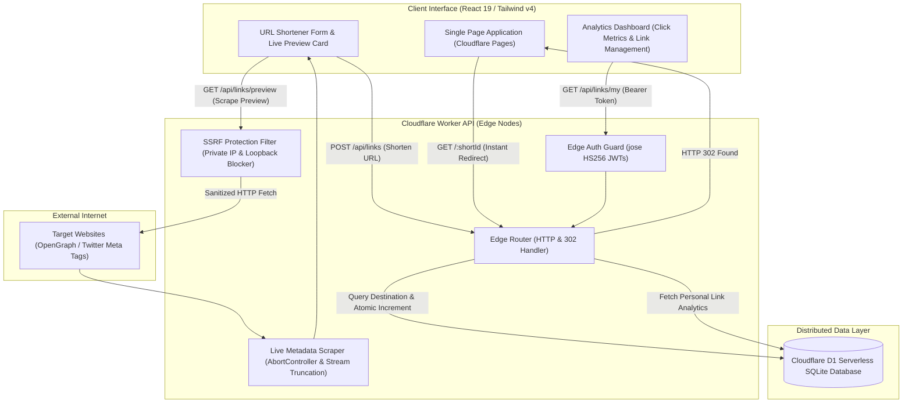

# Snip.ly — Edge-Distributed URL Shortener & Link Analytics

## Sub-50ms Global Edge Redirects, Real-Time Click Tracking, and SSRF-Hardened Metadata Scraping

**Snip.ly** is an open-source, high-performance URL shortening and link analytics platform engineered to run entirely on Cloudflare's serverless edge infrastructure. It solves the latency bottlenecks, cold-start delays, and security risks of traditional centralized URL shorteners by routing global traffic through Cloudflare Workers and Cloudflare D1 distributed SQLite. Snip.ly delivers sub-50ms 302 redirects, atomic click counters, stateless edge authentication, and a live OpenGraph/Twitter card metadata scraper built with comprehensive Server-Side Request Forgery (SSRF) defense.

---

### Tech Stack

- **Client** - React 19, Vite 7, Tailwind CSS v4, React Router 7, Axios, Lucide Icons
- **Server** - Cloudflare Workers (V8 Edge Runtime), Cloudflare D1 (Distributed SQLite), `jose` (Edge JWTs), `bcryptjs`, Base62 `nanoid` *(Legacy fallback: Node.js, Express, MongoDB)*

---

## Architecture & System Workflow

The diagram below outlines the edge lifecycle—from client URL shortening and SSRF-safe scraping to distributed 302 redirect resolution and atomic click increments:



---

## Installation and Usage Instructions (For End-Users)

If you are an evaluator, marketer, or consumer who wants to run and explore Snip.ly locally without modifying source code, follow these quick steps:

### 1. Quick Launch (Run Locally)

Ensure you have **Node.js (v18+)** installed. In your terminal:

```bash
# 1. Clone the repository
git clone https://github.com/h-adarsh/snip-ly.git
cd snip-ly

# 2. Start the Cloudflare Worker API & Local D1 Database (Terminal 1)
cd backend
npm install
cp .dev.vars.example .dev.vars
npx wrangler d1 execute snip-ly-db --local --file=./schema.sql
npm run worker:dev

# 3. Start the Frontend Application (Terminal 2)
cd ../frontend
npm install
cp .env.example .env
npm run dev
```

Once running, access the local services in your browser:
- **Snip.ly Web Dashboard:** [http://localhost:5173](http://localhost:5173)
- **Edge Worker API Base:** [http://localhost:8787](http://localhost:8787)

---

### 2. How to Use the System as a Consumer

#### Shortening Links & Live Previews
1. Navigate to [http://localhost:5173](http://localhost:5173).
2. Paste any long URL into the input field.
3. Snip.ly automatically contacts the metadata scraper to render a live preview card with the target site's title, description, and OpenGraph hero image.
4. Click **Shorten URL** to generate a 6-character collision-resistant Base62 short slug (e.g., `http://localhost:8787/x7K9p2`).
5. Click the copy icon to immediately paste the link into emails, messages, or social posts.

#### Resolving Short Links
1. Open any generated short link (e.g., `http://localhost:8787/x7K9p2`) in your browser.
2. The Cloudflare Worker intercepts the request, atomically increments the click counter in D1, and delivers an instant **HTTP 302 Found** redirect to the original destination in under 50ms.

#### Account Registration & Real-Time Click Analytics
1. Register for an account via the **Sign Up** tab.
2. Once logged in, all shortened links are permanently tied to your profile.
3. Access the **Dashboard** to view:
   - Total lifetime clicks per link.
   - Creation timestamps and original destination URLs.
   - Quick management actions (copy short link, launch live preview, or delete).
4. Toggle between dark and light themes using the navigation bar switch (persisted in `localStorage`).

---

#### Consuming via REST API (Direct Client Usage)
End-users and external applications can interact directly with the Edge API:

- **Shorten a URL (Public):**
  ```bash
  curl -i -X POST http://localhost:8787/api/links/public \
    -H "Content-Type: application/json" \
    -d '{
      "originalUrl": "https://developers.cloudflare.com/workers/"
    }'
  ```

- **Scrape OpenGraph Preview Metadata (SSRF Protected):**
  ```bash
  curl -i -X GET "http://localhost:8787/api/links/preview?url=https://github.com"
  ```

- **Resolve a Short Link (Expect 302 Redirect):**
  ```bash
  curl -i -X GET http://localhost:8787/x7K9p2
  ```

- **Query Authenticated Link Analytics:**
  ```bash
  curl -i -X GET http://localhost:8787/api/links/my \
    -H "Authorization: Bearer <YOUR_EDGE_JWT_TOKEN>"
  ```

---

## Installation and Usage Instructions (For Contributors)

Follow these technical instructions to clone the repository, initialize local Cloudflare D1 SQLite instances, test SSRF protections, and deploy to Cloudflare's global network.

### Prerequisites

- **Node.js:** v18.0.0+ LTS (Tested on v20+)
- **npm:** v9.0.0+
- **Cloudflare Wrangler CLI:** Installed locally via `npm install` (or globally via `npm install -g wrangler`)
- **Cloudflare Account:** *(Optional, only required for production deployment)*

---

### Step 1: Clone Repository & Install Dependencies

```bash
git clone https://github.com/h-adarsh/snip-ly.git
cd snip-ly
```

---

### Step 2: Backend & Local D1 Database Setup

1. Navigate to the backend directory and install edge dependencies:
   ```bash
   cd backend
   npm install
   ```

2. Configure local development secrets:
   ```bash
   cp .dev.vars.example .dev.vars
   ```
   *Edit `.dev.vars` to set a secure secret for signing edge tokens:*
   ```ini
   JWT_SECRET=super_secret_edge_jwt_signing_key_at_least_32_chars
   ```

3. Initialize the local Cloudflare D1 SQLite database with the SQL schema:
   ```bash
   npx wrangler d1 execute snip-ly-db --local --file=./schema.sql
   ```

4. Launch the local Worker server:
   ```bash
   npm run worker:dev
   ```
   *The edge worker will be listening at `http://localhost:8787`.*

---

### Step 3: Frontend Client Setup

1. In a separate terminal, navigate to the frontend directory:
   ```bash
   cd frontend
   npm install
   ```

2. Configure the frontend API target:
   ```bash
   cp .env.example .env
   ```
   Ensure `.env` matches your local Worker instance:
   ```ini
   VITE_API_BASE=http://localhost:8787/api
   VITE_SHORT_DOMAIN=http://localhost:8787
   ```

3. Start the Vite development server:
   ```bash
   npm run dev
   ```
   *The client interface will run at `http://localhost:5173`.*

---

### Step 4: Optional Production Deployment (Cloudflare)

To deploy Snip.ly globally to Cloudflare's edge network:

1. **Deploy Distributed D1 Database:**
   ```bash
   cd backend
   npx wrangler d1 create snip-ly-db
   npx wrangler d1 execute snip-ly-db --remote --file=./schema.sql
   ```
   *Copy the output `database_id` into `backend/wrangler.toml`.*

2. **Deploy Worker API:**
   ```bash
   npx wrangler secret put JWT_SECRET
   npm run worker:deploy
   ```

3. **Deploy Frontend to Cloudflare Pages:**
   - Connect your GitHub repository to Cloudflare Pages.
   - Build Command: `npm run build`
   - Build Output Directory: `dist`
   - Environment Variables:
     - `VITE_API_BASE`: `https://<your-worker>.workers.dev/api`
     - `VITE_SHORT_DOMAIN`: `https://<your-worker>.workers.dev`

---

### Step 5: Optional Legacy Backend (Express + MongoDB)

If you prefer to run the traditional Node.js/Express and MongoDB backend instead of Cloudflare Workers:
```bash
cd backend
# Ensure MONGO_URI and JWT_SECRET are populated in backend/.env
npm run dev
```

---

## Contributor Expectations

We welcome contributions to Snip.ly! To maintain edge runtime compatibility, sub-50ms latency SLAs, and strict network security boundaries, all contributors must observe the following ground rules:

### 1. Workflow & Issues Protocol
- Open an issue prior to implementing major architectural changes, new storage engines, or scraper modifications.
- Reference the issue number in all PR descriptions.

### 2. Branch Naming Conventions
- `feature/<short-description>` — New features (e.g., `feature/custom-alias-slugs`)
- `fix/<short-description>` — Bug fixes (e.g., `fix/ssrf-ipv6-bracket-parsing`)
- `docs/<short-description>` — Documentation updates (e.g., `docs/cloudflare-d1-benchmarks`)
- `refactor/<short-description>` — Code cleanup without behavioral changes

### 3. Commit Message Standards
Follow [Conventional Commits](https://www.conventionalcommits.org/):
- `feat: implement Base62 nanoid generator for custom vanity URLs`
- `fix: prevent SSRF bypass via decimal-encoded IP addresses`
- `test: add edge test cases for atomic D1 click counter increments`
- `docs: update contributor setup steps for Wrangler v3`

### 4. Architectural & Security Ground Rules
- **Non-Negotiable SSRF Defense:** Before fetching any external URL for preview extraction, the host must be verified against the SSRF filter. All loopback addresses (`127.0.0.1`, `localhost`, `::1`), link-local IPs, and RFC 1918 private subnets (`10.0.0.0/8`, `172.16.0.0/12`, `192.168.0.0/16`) must be rejected immediately.
- **Edge Runtime Isolation:** The Worker code runs on the V8 isolate environment (Cloudflare Workers). Do not introduce Node.js native dependencies (`fs`, `net`, `tls`, `http`). Use the Web Standards API (`fetch`, `Request`, `Response`, `CryptoKey`, `AbortController`).
- **Edge-Safe Cryptography:** For JWT verification and generation, use `jose`. Do not use `jsonwebtoken`, which relies on Node-specific crypto modules.
- **Atomic Operations in D1:** Link click increments must execute via atomic SQL operations (`UPDATE links SET clicks = clicks + 1 WHERE id = ?`) to avoid race conditions across concurrent edge requests.

### 5. Pull Request Checklist
1. Worker runs cleanly with no runtime errors under `npm run worker:dev`.
2. Frontend builds without TypeScript or Vite bundling issues (`npm run build`).
3. SSRF tests pass for loopback, local network, and malformed IP payloads.
4. Link the relevant issue (`Closes #<issue_number>`).
