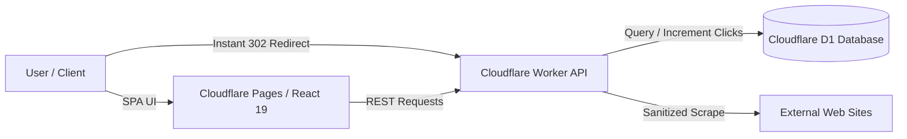

# ⚡ Snip.ly — Edge-Distributed URL Shortener & Link Analytics

[](https://workers.cloudflare.com/)
[](https://developers.cloudflare.com/d1/)
[](https://react.dev/)
[](https://vitejs.dev/)
[](https://tailwindcss.com/)

A modern, high-performance URL shortener and link analytics platform deployed on Cloudflare's serverless edge infrastructure. Designed for low latency global redirects, robust Server-Side Request Forgery (SSRF) defense, live OpenGraph metadata scraping, and real-time click tracking.

---

## 📌 Architecture & Tech Stack



- **Frontend**: React 19, Vite 7, Tailwind CSS v4, Axios, React Router 7
- **Backend / Edge**: Cloudflare Workers (JavaScript ES Modules)
- **Database**: Cloudflare D1 (Serverless Distributed SQLite)
- **Security & Cryptography**: `jose` (Edge JWTs), `bcryptjs`, Custom SSRF Host Filtering
- **ID Generation**: Base62 6-character collision-resistant `nanoid`
- **Legacy Fallback**: Express.js + MongoDB backend included for traditional Node deployments

---

## ✨ Key Features & Engineering Highlights

- ⚡ **Sub-50ms Global Edge Redirects**: Instant 302 redirects resolved at Cloudflare edge nodes with zero cold starts.
- 🛡️ **SSRF Mitigation**: Comprehensive input sanitization that blocks loopback (`localhost`, `127.0.0.1`, `::1`) and RFC 1918 private IPv4/IPv6 ranges before fetching metadata.
- 🖼️ **Live Metadata Scraper**: Real-time OpenGraph and Twitter Card metadata parsing with timeout `AbortController` guards and stream truncation to safely render link preview cards.
- 🔐 **Edge-Compatible Authentication**: Stateless JWT auth powered by `jose` (HS256) and secure password hashing via `bcryptjs`.
- 📊 **Real-Time Click Tracking**: Atomic SQL increments on link access, displayed on an interactive dashboard with link management (copy, delete, preview).
- 🌓 **Persistent Dark Mode**: Fluid dark/light theme switching with localStorage persistence and Tailwind CSS v4.

---

## 📁 Repository Structure

```text
.
├── backend/
│   ├── worker.js           # Cloudflare Worker router & edge business logic
│   ├── schema.sql          # Cloudflare D1 SQLite database schema
│   ├── wrangler.toml       # Cloudflare Workers & D1 configuration
│   ├── server.js           # Legacy Express.js server
│   ├── controllers/        # Legacy Express route controllers
│   ├── models/             # Legacy Mongoose schemas
│   └── routes/             # Legacy Express route definitions
├── frontend/
│   ├── src/
│   │   ├── components/     # LinkItem, LinkList, LinkShortener, Navbar
│   │   ├── pages/          # Home, Dashboard, Login, Register
│   │   ├── services/       # Axios API client
│   │   └── context/        # Authentication & theme context
│   └── vite.config.js      # Vite build & proxy configuration
└── readme.md
```

---

## 🚀 Local Development Setup

### Prerequisites
- Node.js 18+ and `npm`
- Cloudflare Wrangler CLI (`npm install -g wrangler` or via `npx wrangler`)

---

### 1. Backend (Cloudflare Worker + Local D1)

1. Navigate to the backend directory and install dependencies:
   ```bash
   cd backend
   npm install
   ```

2. Create a local `.dev.vars` file for your secrets:
   ```bash
   cp .dev.vars.example .dev.vars
   ```
   *Edit `.dev.vars` to set a secure `JWT_SECRET`:*
   ```env
   JWT_SECRET=your_jwt_secret_here
   ```

3. Initialize the local D1 database schema:
   ```bash
   npx wrangler d1 execute snip-ly-db --local --file=./schema.sql
   ```

4. Start the local Worker server:
   ```bash
   npm run worker:dev
   ```
   *The Cloudflare Worker will start on **`http://localhost:8787`**.*

---

### 2. Frontend (React 19 + Vite)

1. Open a new terminal, navigate to the frontend directory, and install dependencies:
   ```bash
   cd frontend
   npm install
   ```

2. Configure the frontend environment variables:
   ```bash
   cp .env.example .env
   ```
   *(Defaults are set to connect to the local worker on port `8787`)*:
   ```env
   VITE_API_BASE=http://localhost:8787/api
   VITE_SHORT_DOMAIN=http://localhost:8787
   ```

3. Start the Vite development server:
   ```bash
   npm run dev
   ```
   *The frontend dashboard will be available at **`http://localhost:5173`**.*

---

## 📡 API Reference

### Public Endpoints
| Method | Endpoint | Description |
| :--- | :--- | :--- |
| `GET` | `/:shortId` | Resolves short ID, increments click count, and redirects (302) |
| `POST` | `/api/links/public` | Creates a short link without user authentication |
| `GET` | `/api/links/preview?url=<URL>` | Scrapes OpenGraph & Twitter metadata for preview cards |
| `POST` | `/api/auth/register` | Registers a new user account |
| `POST` | `/api/auth/login` | Authenticates user and returns JWT token |

### Authenticated Endpoints (Requires `Authorization: Bearer <token>`)
| Method | Endpoint | Description |
| :--- | :--- | :--- |
| `POST` | `/api/links` | Creates and associates a shortened link with the user |
| `GET` | `/api/links/my` | Fetches all links created by the authenticated user |
| `DELETE` | `/api/links/:id` | Deletes a user's shortened link |

---

## ☁️ Cloudflare Production Deployment

### 1. Deploy Cloudflare D1 Database
Create the remote D1 database and apply the schema:
```bash
npx wrangler d1 create snip-ly-db
npx wrangler d1 execute snip-ly-db --remote --file=./schema.sql
```
*Update `database_id` in `backend/wrangler.toml` with the generated database ID.*

### 2. Set Production Secrets & Deploy Worker
```bash
cd backend
npx wrangler secret put JWT_SECRET
npm run worker:deploy
```

### 3. Deploy Frontend on Cloudflare Pages
Deploy via the Cloudflare Dashboard or Wrangler:
- **Build Command**: `npm run build`
- **Build Output Directory**: `dist`
- **Environment Variables**:
  - `VITE_API_BASE`: `https://<your-worker-subdomain>.workers.dev/api`
  - `VITE_SHORT_DOMAIN`: `https://<your-worker-subdomain>.workers.dev`

---

## 🔄 Legacy Backend (Express + MongoDB)

If you prefer to run the legacy Node/Express and MongoDB backend instead of Cloudflare Workers:
```bash
cd backend
# Ensure MONGO_URI and JWT_SECRET are set in backend/.env
npm run dev
```

---

## 📜 License

This project is licensed under the ISC License.
